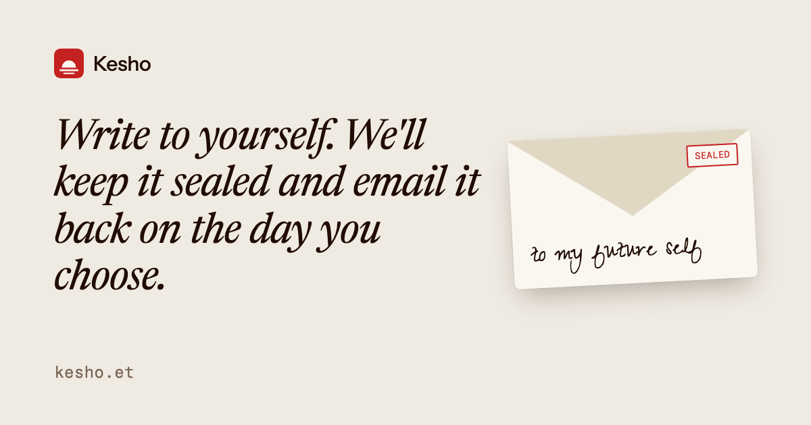

  

# Kesho

**Kesho** (Swahili: *tomorrow*) lets you write a letter to your future self and have it emailed to you on the day you choose.

**[kesho.et](https://kesho.et)**

## How it works

1. **Write.** Say what you want future you to hear. No account needed until you send.
2. **Pick a day.** Six months, a year, five years, or a date of your own, up to five years out.
3. **We seal it.** You can't read it until then. On the day, it lands in your inbox.

Letters are encrypted in the database. Kesho holds the key so it can deliver them, so it isn't end-to-end encryption ([ADR 0002](docs/adr/0002-app-held-key-encryption.md)). Kesho is free, with up to 20 sealed letters at a time.

## Built with

Next.js · Tailwind CSS · Prisma on Neon Postgres · Better Auth · React Email and Resend · Vercel

The full build spec is [docs/SPEC.md](docs/SPEC.md), the domain glossary is [CONTEXT.md](CONTEXT.md), and the decisions behind it are in [docs/adr](docs/adr).

## License

[MIT](LICENSE)
